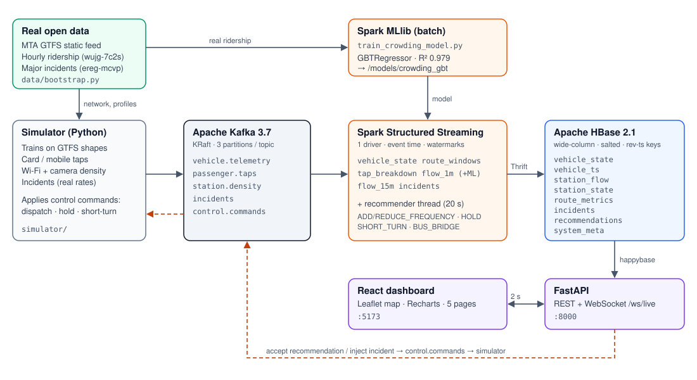

# Real-Time Public Transport & Passenger Flow Optimizer

A complete streaming big-data system for a city metro network: **Kafka → Apache Spark (Structured Streaming + MLlib) → Apache HBase → FastAPI → React dashboard**.
It predicts crowding per station and per train, recommends frequency, holding, short-turn and bus-bridge actions, and analyses how incidents propagate along a line. The whole stack runs locally with one `docker compose up`.



---

## 1. Datasets used: real vs. synthetic

| Data | Source | Real / Synthetic | How it is used |
|---|---|---|---|
| Network: routes, stations, shapes, travel times, headways | **MTA NYC Subway GTFS static feed** – https://rrgtfsfeeds.s3.amazonaws.com/gtfs_subway.zip | **Real** | 12 lines (1 2 3 4 5 6 7 A E L N Q), 301 stations. Map geometry, the trains' paths, and scheduled headways come from GTFS |
| Hourly passenger demand | **MTA Subway Hourly Ridership: 2020–2024** – data.ny.gov dataset `wujg-7c2s` | **Real** (8 weeks: 2 Sep – 27 Oct 2024) | ~396k station-hour rows. Used to train the Spark MLlib crowding model, build demand profiles, and calibrate the tap simulator |
| Incident statistics | **MTA Subway Major Incidents: Beginning 2015** – data.ny.gov dataset `ereg-mcvp` | **Real** (monthly counts since 2023) | Incident rate per line and the category mix (Signals, Track, Persons on trackbed…) drive the live incident generator |
| Vehicle GPS + occupancy sensors | Simulator (`simulator/vehicles.py`) | **Synthetic** | Trains move along the real GTFS shapes. Dwell time grows with boarding volume, so bunching emerges on its own |
| Passenger card / mobile ticket taps | Simulator (`simulator/demand.py`) | **Synthetic, calibrated on real ridership** | Poisson arrivals at each station's real hourly rate. Two JSON schemas (nested v2 + legacy flat) plus 0.4 % corrupt payloads, to exercise semi-structured parsing |
| Station Wi-Fi / camera density | Simulator | **Synthetic** | Derived from simulated people on the platform (Wi-Fi sees ~55 %, cameras ~90 %), with sensor noise and outages |
| Live incidents & maintenance reports | Simulator + dashboard | **Synthetic (real rates)** | Generated at the real per-line rate × a demo multiplier. Can also be injected manually |

`data/bootstrap.py` downloads and processes the real datasets into `data/processed/`. If the internet or a dataset is unavailable, it falls back to a fully **synthetic 6-line city** with the same files (`FULL-SYNTH` mode). The active mode is shown in the dashboard header, and every source is listed on **Pipeline & data → Data sources** (generated from `data/processed/provenance.json`).

> The ridership dataset ID for 2025+ is `5wq4-mkjj`. The 2020-2024 one is used because it has a complete, stable window.

---

## 2. Architecture

```
 simulator (Python) ──► Kafka topics ──► Spark Structured Streaming (1 driver, 6 queries) ──► HBase (8 tables)
   vehicle.telemetry      ▲                 vehicle_state · route_windows · tap_breakdown        │
   passenger.taps         │                 flow_1m (+ MLlib scoring) · flow_15m · incidents      │
   station.density        │                 + recommender thread (every 20 s)                     ▼
   incidents  ◄───────────┤                                                              FastAPI (REST + WebSocket)
   control.commands ◄─────┘◄──── accept a recommendation / inject an incident ──────────── React + Leaflet dashboard

 Spark MLlib batch job: real MTA ridership ──► GBT crowding model (/models/crowding_gbt)
```

**Closed loop:** when you accept a recommendation in the UI, the backend publishes a command to Kafka `control.commands`. The simulator applies it: it dispatches extra trains into the largest gap, holds a bunched train, or short-turns around an incident. The effect then shows up in the live data.

| Component | Tech | Folder |
|---|---|---|
| Data bootstrap | Python, Socrata API, GTFS | `data/` |
| Stream simulator | Python, confluent-kafka | `simulator/` |
| Messaging | Apache Kafka 3.7 (KRaft) | `docker-compose.yml` |
| Stream + batch processing | **Apache Spark 3.5.1 – PySpark Structured Streaming, MLlib** | `spark/jobs/` |
| Storage | **Apache HBase 2.1** via Thrift (happybase) | `hbase/create_tables.hbase`, `spark/jobs/common.py` |
| API | FastAPI, WebSocket | `backend/` |
| Dashboard | React 18, TypeScript, Vite, Leaflet, Recharts, Tailwind | `frontend/` |

---

## 3. Running it

Requirements: Docker Desktop with **≥ 4 GB RAM** (6–8 GB recommended) and internet access on the first run (for the datasets, Maven jars and npm).

On Windows, `.\start.ps1` does everything below. It creates `.env`, builds and starts the stack, waits for the API and opens the dashboard. Use `-Synthetic` for the fully synthetic city, and `-Down` (optionally with `-Wipe`) to stop. Or run it by hand:

```bash
docker compose up -d --build
# dashboard     http://localhost:5173
# API docs      http://localhost:8000/docs
# Spark UI      http://localhost:4040
# HBase UI      http://localhost:16010
```

First start: `bootstrap` downloads the data (about 4 min; skipped if `data/processed/` exists). Then the `spark` container trains the model (about 3 min; skipped if `models/crowding_gbt` exists) and starts streaming. The dashboard fills within about a minute after that.

Useful settings (environment variables or `.env`, see `.env.example`):

| Variable | Default | Meaning |
|---|---|---|
| `SIM_SPEED` | 6 | simulated seconds per real second |
| `SIM_START` / `SIM_DAY` | `07:00` / `weekday` | start in the weekday morning rush (`SIM_START=now`, `SIM_DAY=today` for wall-clock time) |
| `FLEET_SCALE` | 0.5 | share of the scheduled fleet simulated (lower = more crowding and recommendations) |
| `INCIDENT_MULTIPLIER` | 40 | × the real MTA incident rate, so incidents appear every few minutes |
| `SPARK_MASTER` | `local[6]` | Spark master URL |

Other commands:

```bash
docker compose logs -f spark simulator            # watch the pipeline
docker compose run --rm -e FORCE_REBUILD=1 bootstrap   # re-download / rebuild datasets
docker compose run --rm -e FORCE_SYNTHETIC=1 -e FORCE_REBUILD=1 bootstrap   # fully synthetic city
rm -rf models/* && docker compose restart spark   # retrain the MLlib model
docker compose down -v                            # stop and wipe HBase / checkpoints / sim clock
```

Tests: `cd backend && python -m pip install -r requirements-dev.txt && DATA_DIR=../data/processed python -m pytest -q` (HBase and Kafka are faked). Use **Python 3.11**, the same as the backend image: `confluent-kafka 2.5.3` has no wheel for 3.13.

### Demo script (5 minutes)
1. **Live map**: trains coloured by load and ringed in their line colour; stations coloured by crowding. Switch "predicted +30 min" to see where it will get crowded.
2. **Incidents & impact**: inject a severity-3 incident on the 4 line at Grand Central. Trains behind it stop, the delay-propagation bar chart grows, and a BUS_BRIDGE recommendation appears.
3. **Recommendations**: accept it (or an ADD_FREQUENCY / HOLD). The command goes through Kafka, and the simulator applies it. Watch the bunching index and headway charts.
4. **Incidents → demand surge** at Times Sq, then **Crowding forecast** for that station: the forecast lines rise ahead of the actual crowding.
5. **Pipeline & data**: live Spark query throughput, Kafka topic rates, tap-schema parsing stats, model metrics vs. baselines, the HBase schema with sample rows, and data provenance.

---

## 4. HBase wide-column design

Row keys are designed around the read pattern of each table.

* **Reversed timestamps** (`9999999999999 − epoch_ms`): a prefix scan returns the newest rows first, so "last N windows" needs no sort.
* **Salting** (`crc32(id) % 4` prefix): monotonically increasing time-series writes are spread across regions (pre-split on `1`,`2`,`3`), which avoids a hot region.

| Table | Row key | Column families | Why |
|---|---|---|---|
| `vehicle_state` | `vehicle_id` | `loc` (VERSIONS 20), `occ` (VERSIONS 20), `ops` | **Current state**, overwritten in place: O(1) reads for the live map. Cell versions double as a short GPS/occupancy trail (`/api/vehicles/{id}` reads them) |
| `vehicle_ts` | `salt#route#vehicle#revTs` | `d` (TTL 7 d) | Full telemetry **time series**. `prefix = salt#route#vehicle#` returns one train's history newest-first |
| `station_flow` | `station#window#revWindowStart` | `tap`, `den`, `pred` (TTL 30 d) | **Passenger-flow windows** (`1m`, `15m`). `tap:card_<TYPE>` / `tap:transfers` are **dynamic columns** updated with **atomic HBase counters** |
| `station_state` | `station_id` | `cur`, `pred` (VERSIONS 10) | Latest flow + forecast per station. Versions keep recent forecasts |
| `route_metrics` | `route#revWindowStart` | `m` | Per-minute route KPIs: load, p90 load, delay, headway (actual / effective / scheduled), bunching |
| `incidents` | `salt#incident_id` | `info`, `impact` | `impact:st_<station>` dynamic columns hold the propagated delay per station |
| `recommendations` | `route#revTs#action` | `rec` (TTL 7 d) | Workflow: `rec:status` NEW → ACCEPTED / DISMISSED |
| `system_meta` | `clock`, `pipeline`, `query:<name>`, `taps` | `s` | Sim clock, Spark progress (from a `StreamingQueryListener`), tap-schema counters, provenance |

DDL with pre-splits: `hbase/create_tables.hbase`. The Spark driver creates the same tables automatically through Thrift.

---

## 5. Spark processing

| Query / job | Kind | Details |
|---|---|---|
| `vehicle_state` | micro-batch, 5 s | `from_json` → upsert `vehicle_state`, append `vehicle_ts`. Computes headway, rider-weighted effective headway, bunching index (CV of gaps) and a hold candidate per line. Predicts each train's load 15 min ahead from boarding/alighting at its next stops |
| `route_windows` | stateful, event time | `withWatermark(2 min)` + 1-min tumbling `window()` per route: avg / max / p90 load, delay, speed, distinct vehicles |
| `tap_breakdown` | micro-batch | Normalises **two tap schemas** (nested v2 / flat legacy) with `coalesce`, and quarantines corrupt JSON. Card-type counts → HBase atomic counters |
| `flow_1m` | stateful, event time | **Multi-stream fusion**: taps ∪ density → 1-min windows per station. Fused people count = mean(Wi-Fi/0.55, camera/0.9). Then **MLlib model scoring** on the driver → `crowd_now / +15 / +30 min` |
| `flow_15m` | stateful, event time | 15-min **sliding** windows (5-min slide) |
| `incidents` | micro-batch | Upserts incidents and computes impact: delay at the incident station = elapsed × severity factor, decaying 0.85 per stop along the line. Affected riders = on board + waiting + arriving before clearance |
| recommender | driver thread, every 20 s | ADD_FREQUENCY (`required headway = headway × target load / predicted load` → extra trains), REDUCE_FREQUENCY (respecting a 12-min service standard), HOLD (bunching > 0.5), SHORT_TURN (severity 2), BUS_BRIDGE (severity 3) |
| `train_crowding_model.py` | batch MLlib | GBTRegressor on real ridership. Learns the **ratio to the historical profile** (scale-free across small and huge stations). Uses a time-based split with the last 2 weeks held out |

**Model results** (test = last 2 weeks of Oct 2024, entries per station-hour):

| Model | RMSE | MAE | R² |
|---|---|---|---|
| **Spark GBT (ratio target)** | **109.2** | **36.3** | **0.979** |
| Historical profile baseline | 169.1 | 62.1 | 0.950 |
| Persistence (last hour) baseline | 320.9 | 143.5 | 0.821 |

---

## 6. API

| Method | Path | Description |
|---|---|---|
| GET | `/api/network` | routes (GTFS shapes, colours), stations with demand profiles |
| GET | `/api/live` · WS `/ws/live` | vehicles + stations + open incidents + KPIs (WebSocket pushes every 2 s) |
| GET | `/api/vehicles/{id}` · `/history?minutes=` | current state + version trail · time series from `vehicle_ts` |
| GET | `/api/stations/{id}/flow?window=1m\|15m` | flow windows, predictions, card counters |
| GET | `/api/routes` · `/api/routes/{id}/metrics` | route KPIs per window |
| GET/POST | `/api/recommendations` · `/{id}/accept\|dismiss` | accept publishes to Kafka `control.commands` |
| GET/POST | `/api/incidents` | list / inject (published to Kafka `incidents`) |
| POST | `/api/simulate/surge` | demand surge at a station |
| GET | `/api/system/health` · `/api/system/schema` | Kafka, Spark, HBase status, model metrics, provenance, live HBase schema |

Interactive docs: http://localhost:8000/docs

---

## 7. Notes and limitations

* Simulated time is the city's local time encoded as UTC epoch ms everywhere, so hour-of-day features match the ridership data.
* Each tap event represents 10 riders (`weight`), which keeps Kafka at ~200 msg/s on a laptop.
* HBase counters are at-least-once: if a micro-batch is retried, counts can be slightly inflated. Everything else is written idempotently (deterministic row keys).
* Spark runs in `local[6]` mode inside one container to fit a 4 GB Docker VM. The code is cluster-ready (`SPARK_MASTER=spark://…` plus a shared checkpoint volume).
* The real ridership data counts entries per *station complex*. Complexes are mapped to the GTFS stations within 250 m, splitting the count evenly between them.
